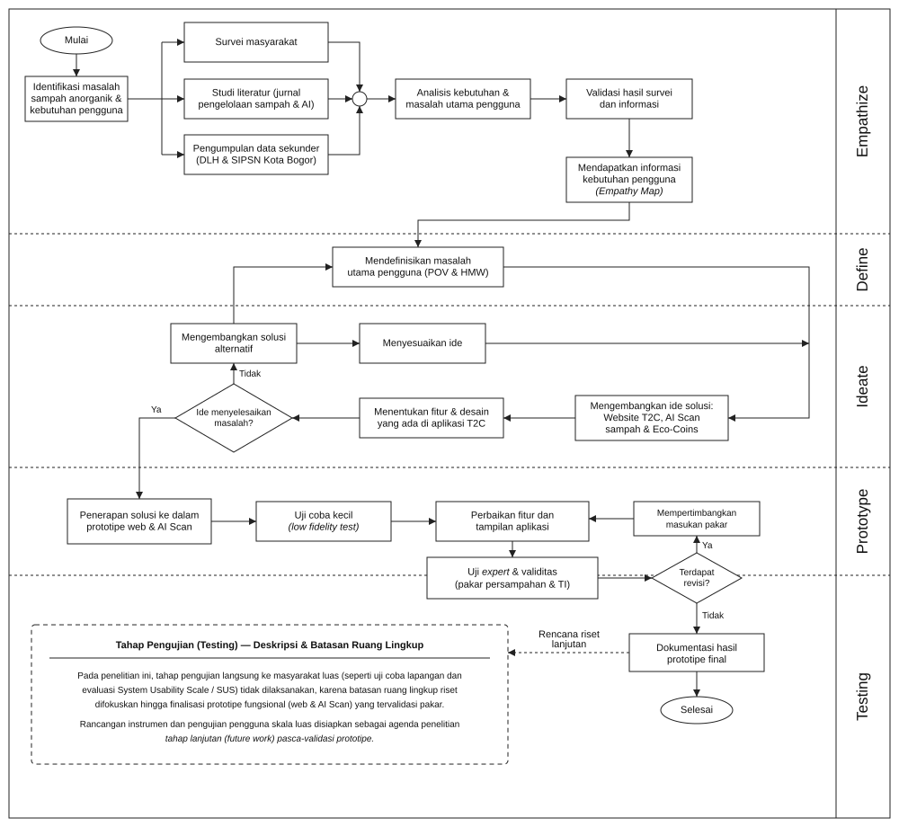

# RANCANG BANGUN PLATFORM PENGELOLAAN SAMPAH ANORGANIK BERBASIS COMPUTER VISION, IOT SMART BIN, DAN GAMIFIKASI FINANSIAL DENGAN PENDEKATAN DESIGN THINKING (STUDI KASUS: KOTA BOGOR)

---

## 📌 ABSTRAK
Pertumbuhan volume timbulan sampah perkotaan di Kota Bogor—yang mencapai lebih dari 650–700 ton per hari—menghadapi tantangan kritis berupa keterbatasan kapasitas TPA Galuga, tingginya tingkat kontaminasi sampah anorganik tercampur (>65%), serta rendahnya insentif pemilahan di tingkat sumber rumah tangga maupun area komersial/perkantoran. Penelitian ini bertujuan merancang dan memvalidasi prototipe **Trash-to-Cash (T2C)**, sebuah platform keberlanjutan berbasis pendekatan **Design Thinking** (*Empathize, Define, Ideate, Prototype, Test*) yang mengintegrasikan verifikasi awal menggunakan *Artificial Intelligence (AI) Computer Vision*, *IoT Smart Bin*, dan gamifikasi insentif ekonomi mikro (*Eco-Coins*). Melalui pendekatan *AI Pre-Scan*, pengguna memvalidasi jenis dan kebersihan sampah sebelum membawanya ke tempat pembuangan, menghasilkan tiket digital (*Digital Drop Pass*) berbasis token QR, dan mencairkan insentif secara instan setelah sensor bobot (*load cell*) Smart Bin memverifikasi beban fisik. Hasil pengujian prototipe menunjukkan bahwa mekanisme *pre-scan* mampu mengeliminasi friksi antrean pada *smart bin* fisik, menekan potensi penolakan sampah daur ulang akibat kontaminasi, serta memberikan jejak audit emisi karbon ($CO_2$) yang terukur secara real-time.

**Kata Kunci:** *Design Thinking, Trash-to-Cash, Computer Vision, IoT Smart Bin, Gamifikasi, Pengelolaan Sampah Kota Bogor, ESG.*

---

## 1. PENDAHULUAN & EMPATHIZE (MEMAHAMI MASALAH DI BOGOR)

### 1.1. Latar Belakang & Konteks Wilayah (Kota Bogor)
Kota Bogor sebagai kota penyangga metropolitan Jabodetabek mengalami peningkatan timbulan sampah seiring laju urbanisasi dan sektor pariwisata kuliner/komersial. Meskipun Pemerintah Kota Bogor telah menginisiasi regulasi pelarangan kantong plastik sekali pakai (Perwali No. 61/2018) dan mendorong program bank sampah unit (BSU), efektivitas sirkularitas sampah daur ulang menghadapi tiga hambatan struktural:
1. **Bottleneck TPA Galuga**: Beban harian pembuangan akhir melampaui kapasitas ideal, di mana lebih dari 40% material yang terbuang sebenarnya merupakan fraksi bernilai ekonomi (plastik PET, kaleng aluminium, kertas/karton).
2. **Friksi Pemilahan & Kontaminasi Masif**: Sampah bernilai daur ulang sering kali tercampur residu makanan dan cairan organik. Hal ini menurunkan nilai jual material daur ulang hingga 70–80% dan memicu penolakan dari industri peleburan daur ulang (*recycler*).
3. **Ketiadaan *Immediate Gratification* (Insentif Langsung)**: Model bank sampah konvensional memerlukan penimbangan manual terjadwal (misal: seminggu atau sebulan sekali), pencatatan buku fisik, dan pembagian hasil yang lambat, sehingga gagal menarik kelompok usia produktif dan generasi muda urban.

### 1.2. Tahap 1: Empathize (Empati Pengguna & Stakeholder)
Riset lapangan dan observasi di Bogor (melibatkan masyarakat urban, pekerja perkantoran, dan pengelola bank sampah/TPS3R) memetakan respons pengguna:

| Stakeholder / Persona | Temuan Empati & Keluhan (*Pains*) | Harapan (*Gains*) |
| :--- | :--- | :--- |
| **Masyarakat Urban & Karyawan Muda (Bogor)** | - "Malas memilah karena ujung-ujungnya dicampur oleh petugas sampah."<br>- "Bank sampah buka hanya hari tertentu dan harus bawa karung besar."<br>- "Tidak ada apresiasi langsung jika saya repot mencuci dan mengeringkan botol." | - Ingin reward instan (saldo e-wallet, voucher kopi).<br>- Pengalaman praktis layaknya bermain game di smartphone.<br>- Transparansi bahwa sampahnya benar-benar didaur ulang. |
| **Pengepul / Industri Daur Ulang Lokal** | - "Banyak botol plastik masih berisi sisa cairan atau kotoran tanah."<br>- "Biaya sortir manual untuk mencuci sampah terlalu mahal." | - Sampah datang dalam keadaan bersih, terpilah rapi, dan pipih/kempes. |
| **Pemerintah Kota & Korporasi (Inisiatif ESG)** | - Sulit memvalidasi data klaim reduksi jejak karbon per warga/pegawai.<br>- Program sosialisasi sering kali bersifat pasif dan berhenti di seremonial. | - Dasbor metrik akurat (*kg waste diverted*, $CO_2$ *avoided*) yang siap diaudit. |

---

## 2. DEFINE (PENETAPAN MASALAH & USER NEEDS)

### 2.1. Point of View (POV) Framework
> **Pengguna (Masyarakat Urban & Karyawan di Bogor)** membutuhkan **metode pemilahan dan penyetoran sampah anorganik yang cepat, menyenangkan, dan memberikan reward bernilai ekonomi riil secara instan**, karena **kebiasaan memilah saat ini terhambat oleh proses manual bank sampah yang lambat, ketiadaan umpan balik dampak lingkungan, dan tingginya angka penolakan akibat sampah kotor tercampur.**

### 2.2. Rumusan "How Might We" (HMW)
1. **HMW-1**: Bagaimana kita memverifikasi kebersihan dan jenis sampah *sebelum* disetorkan agar Smart Bin tidak kotor atau rusak oleh residu cairan?
2. **HMW-2**: Bagaimana kita mengubah aktivitas menyetor sampah dari beban kewajiban menjadi aktivitas gamifikasi yang adiktif secara positif (*habit-forming*)?
3. **HMW-3**: Bagaimana kita menghubungkan transaksi fisik sampah dengan insentif finansial terdesentralisasi secara instan tanpa kecurangan (*fraud*)?

## 3. IDEATE (PERUMUSAN SOLUSI & ARSITEKTUR KONSEPTUAL)

Sebagai jawaban dari tantangan di atas, dirumuskan platform **T2C (Trash-to-Cash)** dengan arsitektur integrasi 3 pilar:
1. **AI Computer Vision Pre-Scan**: Algoritma pengenalan citra mendeteksi kategori material (PET, Aluminium, Karton) serta mengevaluasi *Cleanliness Score* langsung dari kamera smartphone pengguna.
2. **Digital Drop Pass (Time-Locked QR)**: Token digital unik (misal: `DP-2026-XXXX`) yang mengunci estimasi reward dan kategori material selama 24 jam. Ini mencegah kerumunan/antrean verifikasi di titik tong sampah.
3. **IoT Smart Bin Validation & Immediate Payout**: Pintu tempat sampah hanya terbuka saat memindai QR Drop Pass. Sensor timbangan (*load cell*) mencocokkan berat fisik aktual sampah. Apabila toleransi berat terpenuhi, saldo koin digital (*Eco-Coins*, rasio 1 koin = Rp 100) langsung cair ke akun pengguna beserta penambahan XP dan progres pohon virtual (*EcoTree*).

### 3.1. Flowchart Proses Penciptaan Ide (Ideation & Design Thinking Genesis)

Berikut adalah diagram alir (*swimlane flowchart*) yang memetakan bagaimana ide inovasi T2C lahir melalui 5 tahapan iteratif *Design Thinking*:



*Gambar 1. Flowchart Tahapan Design Thinking Pengembangan Prototipe T2C*

---

## 4. FLOWCHART SISTEM & ALUR OPERASIONAL (METHODOLOGY & SYSTEM ARCHITECTURE)

Berikut adalah diagram alir (*flowchart*) operasional platform T2C dari ujung ke ujung (*End-to-End Workflow*):

```mermaid
flowchart TD
    Start([Mulai: Pengguna Membuka Aplikasi T2C]) --> Login{Sudah Terautentikasi?}
    Login -- Tidak --> Auth[Sign In / Sign Up / Corporate SSO] --> Login
    Login -- Ya --> MenuScan[Pilih Menu: AI Pre-Scan]
    
    MenuScan --> Capture[Ambil Foto Sampah via Kamera HP]
    Capture --> AIProcess[Model AI Computer Vision Menganalisis Citra]
    
    AIProcess --> EvalClean{Skor Kebersihan >= 70% & Jenis Valid?}
    EvalClean -- Tidak --> RejectTip[Tampilkan Saran Koreksi:\nCuci, Keringkan, atau Pipihkan Sampah]
    RejectTip --> Capture
    
    EvalClean -- Ya --> GeneratePass[Terbitkan 'Digital Drop Pass'\nToken QR Terenkripsi + Estimasi Reward Terkunci]
    
    GeneratePass --> UserWalk[Pengguna Membawa Sampah ke IoT Smart Bin]
    UserWalk --> ScanBin[Scan QR Drop Pass di Scanner Smart Bin]
    
    ScanBin --> OpenFlap[Pintu Kompartemen Bin Terbuka Otomatis]
    OpenFlap --> DropTrash[Pengguna Memasukkan Sampah ke Bin]
    DropTrash --> CloseWeight[Pintu Menutup & Sensor Load Cell Menimbang Bobot Aktual]
    
    CloseWeight --> MatchWeight{Bobot Aktual Sesuai Estimasi AI?\n(Toleransi ±15%)}
    MatchWeight -- Tidak Cocok --> FlagAudit[Catat Anomali / Penyesuaian Nilai Reward Koin]
    MatchWeight -- Cocok --> AutoCredit[Kreditkan Eco-Coins & XP Instan ke Akun Pengguna]
    FlagAudit --> AutoCredit
    
    AutoCredit --> Feedback[Feedback Haptik & Audio Chime + Animasi Confetti]
    Feedback --> TreeGrowth[Perbarui Status EcoTree, Streak, & Leaderboard Divisi]
    
    TreeGrowth --> CashoutChoice{Ingin Menukar Reward?}
    CashoutChoice -- Ya --> Marketplace[Pilih: Saldo GoPay/OVO/DANA, Voucher Kuliner, atau Adopsi Pohon]
    Marketplace --> RedeemSuccess[Kode Voucher / Saldo Diterbitkan]
    CashoutChoice -- Tidak --> End([Selesai / Kembali ke Beranda])
    RedeemSuccess --> End
```

---

## 5. PROTOTYPING & SPESIFIKASI IMPLEMENTASI

Prototipe dikembangkan sebagai *Single Page Progressive Web Application* (PWA) berkecepatan tinggi dengan spesifikasi teknis:
- **Frontend Core**: React 19, Vite 8.2.
- **Antarmuka & Gaya**: TailwindCSS v4, Lucide Icons, Glassmorphism UI bertema hijau keberlanjutan (*Emerald-Teal Palette*).
- **Simulasi Hardware**: Komponen `SmartBinSim` yang mensimulasikan protokol komunikasi data timbangan beban IoT dan QR barcode reader.
- **Model Tokenomics Mikro**:
  $$\text{Nilai Rupiah} = \text{Eco-Coins} \times 100$$
  - Contoh: 4 botol plastik PET bersih (~0.18 kg) = **15 Eco-Coins (Rp 1.500)** + **30 XP**.
  - 6 kaleng aluminium (~0.15 kg) = **35 Eco-Coins (Rp 3.500)** + **50 XP**.
- **Metrik Konversi Lingkungan (ESG Metrics)**:
  - Reduksi Karbon: $1\text{ kg PET didaur ulang} \approx 1.5\text{ kg } CO_2\text{ dihemat}$.
  - Rekonsiliasi Pohon: $10\text{ kg sampah terkelola} \approx 0.1\text{ pohon terselamatkan}$.

---

## 6. KESIMPULAN & ARAH PENGEMBANGAN RISET (FUTURE WORK)

Pendekatan *Design Thinking* pada rancang bangun platform T2C membuktikan bahwa perpaduan antara **verifikasi pra-setor berbasis citra (AI Pre-Scan)** dan **insentif ekonomi tergamifikasi** mampu mengatasi friksi klasik bank sampah konvensional di wilayah perkotaan seperti Kota Bogor. 

Langkah pengembangan selanjutnya (*Next Research Stages*):
1. **Model Edge-AI**: Mengintegrasikan model *TensorFlow Lite* / *YOLOv8-Nano* langsung di perangkat peramban agar deteksi citra dapat berjalan *offline*.
2. **Pilot Testing TPS3R / Smart Building**: Uji lapangan penempatan unit Smart Bin fisik di fasilitas publik Kota Bogor (misal: Balai Kota, Alun-alun Bogor, atau area stasiun) untuk mengukur *System Usability Scale (SUS)* dan *Habit Retention Rate* selama 30 hari.
