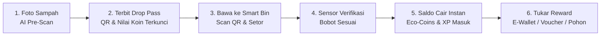

# 🌿 T2C (Trash-to-Cash) — Platform Inovasi Pengelolaan Sampah Berbasis AI & Gamifikasi

[](https://prototype-t2-c.vercel.app)


---

## 📌 1. Ringkasan Eksekutif (Executive Summary)

**T2C (Trash-to-Cash)** adalah platform digital keberlanjutan (*ESG Sustainability Platform*) yang merevolusi cara pengelolaan sampah anorganik di lingkungan perkantoran dan komunitas perkotaan. Platform ini menjembatani kebiasaan memilah sampah dengan insentif ekonomi nyata melalui integrasi **AI Computer Vision**, **IoT Smart Bin**, dan **Gamifikasi Finansial (Eco-Coins)**.

Melalui sistem **Pre-Scan Verification**, pengguna memverifikasi kebersihan dan kelayakan daur ulang sampah terlebih dahulu di meja kerja, memperoleh **Digital Drop Pass (QR)**, lalu menyetorkannya ke **Smart Bin** untuk mendapatkan saldo reward instan yang dapat dicairkan ke saldo E-Wallet, voucher merchant, atau donasi penanaman pohon.

---

## 🎯 2. Latar Belakang & Masalah Bisnis (Problem Statement)

1. **Rendahnya Partisipasi Pemilahan Sampah**: Di area perkantoran, pemilahan sampah sering kali gagal karena kurangnya motivasi langsung dan tidak adanya umpan balik (*feedback loop*) yang terukur.
2. **Kontaminasi Sampah Daur Ulang**: Sampah bernilai ekonomi (seperti botol PET & kaleng aluminium) sering tercampur sisa makanan atau cairan kotor, sehingga menurunkan nilai daur ulang hingga 80% atau ditolak oleh industri daur ulang (*recycler*).
3. **Ketiadaan Pelaporan ESG Terukur**: Perusahaan kesulitan melacak kontribusi nyata per individu maupun per divisi dalam inisiatif *Net-Zero Waste* dan *Carbon Reduction*.

---

## 💡 3. Solusi & Value Proposition (Nilai Tambah)

| Fitur Solusi | Manfaat Bisnis & Pengguna |
| :--- | :--- |
| **AI Pre-Scan Verification** | Mencegah antrean dan kontaminasi di Smart Bin dengan melakukan klasifikasi jenis, bobot estimasi, dan skor kebersihan langsung dari kamera HP. |
| **Digital Drop Pass (QR Token)** | Menghubungkan identitas pengguna dengan sampah yang disetor untuk pencatatan jejak audit (*traceability*) dan *Trust Score*. |
| **IoT Smart Bin Validation** | Sensor timbangan otomatis membaca QR Drop Pass dan memverifikasi kesesuaian sampah sebelum mengunci transaksi dan mencairkan koin. |
| **Eco-Coins Economic System** | Konversi nilai sampah yang transparan (**1 Eco-Coin = Rp 100**) yang dapat langsung dibelanjakan di Reward Store. |
| **Gamifikasi Pohon Virtual & Leaderboard** | Meningkatkan retensi pengguna harian melalui fitur pohon virtual (*EcoTree*), panen embun harian, streak, misi harian, dan kompetisi antar divisi. |

---

## 🔄 4. Alur & Cara Kerja Sistem (End-to-End Workflow)



### Langkah Kerja Detail:

1. **Tahap 1: AI Pre-Scan (Verifikasi Awal)**
   - Pengguna membuka menu **AI Scan** dan memindai sampah anorganik (misal: botol plastik PET pipih, kaleng aluminium, kardus).
   - AI mengenali kategori sampah, mengukur tingkat kebersihan (*cleanliness score*), estimasi bobot, nilai koin, dan estimasi reduksi jejak karbon ($CO_2$).
2. **Tahap 2: Penerbitan Digital Drop Pass**
   - Sistem menerbitkan tiket QR digital bertanda pengenal unik (misal: `DP-2026-9812`) yang mengunci nilai reward selama 24 jam.
3. **Tahap 3: Penyetoran di IoT Smart Bin**
   - Pengguna membawa sampah ke titik **Smart Bin** terdekat.
   - Pintu Smart Bin terbuka setelah memindai QR Drop Pass.
   - Sensor beban (*load cell*) menimbang fisik sampah secara *real-time*.
4. **Tahap 4: Pencairan Reward Instan**
   - Begitu bobot tervalidasi, koin langsung masuk ke akun pengguna dengan efek audio dan haptik.
5. **Tahap 5: Belanja di Reward Store & Pelaporan ESG**
   - Pengguna menukarkan Eco-Coins dengan saldo E-Wallet (GoPay/OVO/DANA), voucher kopi/makan, atau adopsi bibit pohon mangrove lengkap dengan e-sertifikat.

---

## 💰 5. Model Ekonomi & Tokenomics

- **Rasio Konversi Nilai**:  
  $$\mathbf{1\ Eco\text{-}Coin = Rp\ 100}$$
- **Contoh Valuasi Sampah**:
  - *4x Botol PET Pipih Bersih (~0.18 kg)* = **+15 Koin (Rp 1.500)** + 30 XP
  - *6x Kaleng Minuman Aluminium (~0.15 kg)* = **+35 Koin (Rp 3.500)** + 50 XP
  - *2.5 kg Kardus / Kertas Arsip* = **+50 Koin (Rp 5.000)** + 80 XP
  - *Bonus Pendaftaran Akun Baru* = **+50 Koin (Rp 5.000)**
  - *Panen Embun Harian (Daily Dew)* = **+5 Koin (Rp 500)**

---

## ✨ 6. Modul & Fitur Utama Aplikasi

### 📱 A. Autentikasi & Profil Akun
- **Sign In & Sign Up Form**: Registrasi cepat dengan ID Karyawan/Pengguna, email korporat/pribadi, nomor WhatsApp, serta pilihan divisi.
- **Corporate Single Sign-On (SSO)**: Akses 1-klik untuk integrasi identitas korporat.
- **Preset Akun Demo**: Tombol uji cepat login instan (*Budi - Digital Innovation* / *Citra - Sustainability*).
- **Modal Profil & Sign Out**: Menampilkan level, bar progress XP, Trust Score, status rekening bank/e-wallet terhubung, serta tombol *Sign Out* dengan dialog konfirmasi interaktif.

### 📊 B. Dashboard & Eco-Wallet
- **Saldo Finansial**: Menampilkan total Eco-Coins terkumpul serta ekuivalen nilai Rupiah secara *live*.
- **Ringkasan Dampak ESG**:
  - Total Kg Sampah Diselamatkan
  - Total Reduksi Emisi $CO_2$ (kg)
  - Ekuivalen Pohon Terselamatkan
  - Total Frekuensi Penyetoran (Drops)
- **Riwayat Mutasi Saldo**: Pencatatan log transaksi masuk (*Drop Success*) dan keluar (*Redeem Reward*).

### 🌳 C. EcoTree & Gamifikasi Harian
- **Visualisasi Pohon Virtual**: Pohon bertumbuh melewati 5 fase (*Tunas*, *Bibit Muda*, *Pohon Rindang*, *Pohon Berbunga*, hingga *Pohon Dewasa Raksasa*) sesuai akumulasi level dan aktivitas daur ulang.
- **Daily Dew (Panen Embun)**: Klaim bonus koin harian untuk mendorong *daily active user (DAU)*.
- **Streak Tracker**: Indikator konsistensi harian setor sampah dengan pengali (*boost multiplier*).

### 🏆 D. Misi & Leaderboard
- **Sistem Quest Harian & Mingguan**: Tantangan terstruktur (contoh: *"Setor 3 Hari Berturut-turut"*, *"Pilah 1kg Plastik"*) dengan reward XP dan koin ekstra.
- **Leaderboard 2 Kategori**:
  - *Peringkat Individu*: Kompetisi antar rekan kerja.
  - *Liga Divisi & Tim*: Papan skor agregat untuk memupuk semangat kolaborasi tim unit kerja.

### 🛍️ E. Reward Marketplace
- **Kategori Hadiah Beragam**:
  - *E-Wallet*: Top-up saldo GoPay, OVO, DANA.
  - *Food & Beverage*: Voucher diskon Fore Coffee, Kopi Kenangan, dll.
  - *ESG & Philanthropy*: Adopsi bibit mangrove dengan e-sertifikat bernomor seri.

---

## 🛠️ 7. Tech Stack & Arsitektur Perangkat Lunak

- **Core Framework**: React 19 (`react`, `react-dom`)
- **Build Tooling**: Vite 8.2 (Fast HMR & Optimized Bundle Chunking)
- **Styling & Design System**: TailwindCSS v4 + Vanilla CSS Custom Animation
- **Icons**: Lucide React
- **Micro-Interactions**:
  - `canvas-confetti` untuk animasi selebrasi Level Up & Drop Success
  - Web Audio API (*synthesized sound effects* untuk koin, level up, dan sukses)
  - Mobile Haptic Feedback API (`navigator.vibrate`)
- **Hosting & Deployment**: Vercel SPA Ready (`vercel.json` routing configuration)

---

## 🚀 8. Panduan Menjalankan Proyek (Local Setup)

### Prasyarat:
- Node.js versi 18 ke atas
- NPM / PNPM / Yarn

### Langkah Instalasi:

1. **Clone repositori**:
   ```bash
   git clone https://github.com/AlfatTaufik/trash2cash.git
   cd "Prototype - T2C"
   ```

2. **Install dependensi**:
   ```bash
   npm install
   ```

3. **Jalankan local development server**:
   ```bash
   npm run dev
   ```
   *Buka browser di `http://localhost:5173/`.*

4. **Build untuk Produksi**:
   ```bash
   npm run build
   ```

5. **Deploy ke Vercel**:
   ```bash
   npx vercel --prod
   ```

---

## 📂 9. Struktur Folder Proyek

```text
Prototype - T2C/
├── public/                  # Aset statis & favicon
├── src/
│   ├── assets/              # Gambar dan aset multimedia
│   ├── components/
│   │   ├── Auth/
│   │   │   ├── SignIn.jsx   # Layar Masuk Akun & SSO
│   │   │   └── SignUp.jsx   # Layar Registrasi Akun Baru
│   │   ├── AndroidTopBar.jsx      # Header, profil, & kartu saldo Eco-Coins
│   │   ├── AndroidBottomNav.jsx   # Navigasi tab bawah (Beranda, Bin, Scan, Misi, Hadiah)
│   │   ├── BottomSheetPass.jsx    # Modal QR Drop Pass & Voucher
│   │   ├── Dashboard.jsx          # Ringkasan analitik ESG & mutasi koin
│   │   ├── EcoTree.jsx            # Gamifikasi pohon virtual & animasi pertumbuhan
│   │   ├── Leaderboard.jsx        # Papan peringkat individu & divisi
│   │   ├── Marketplace.jsx        # Reward store (e-wallet, voucher, donasi pohon)
│   │   ├── PreScan.jsx            # Simulasi AI Computer Vision klasifikasi sampah
│   │   ├── ProfileModal.jsx       # Modal profil, pengaturan akun, & Sign Out
│   │   ├── Quests.jsx             # Misi harian, mingguan, & lencana prestasi
│   │   └── SmartBinSim.jsx        # Simulator sensor hardware Smart Bin
│   ├── context/
│   │   └── AppContext.jsx   # State management global, efek suara, haptic & logic
│   ├── data/
│   │   └── mockData.js      # Data awal katalog sampah, quest, leaderboard & rewards
│   ├── App.jsx              # Komponen utama & layout routing
│   ├── index.css            # Desain token TailwindCSS & animasi keyframe
│   └── main.jsx             # Entry point React
├── index.html               # Template dokumen HTML
├── package.json             # Manifest dependensi & scripts
├── vercel.json              # Konfigurasi routing single page application
└── README.md                # Dokumentasi komprehensif proyek
```

---

## 📈 10. Indikator Keberhasilan Bisnis (Key Impact Metrics)

1. **Tingkat Daur Ulang Bersih**: Menurunkan angka kontaminasi sampah anorganik hingga $\mathbf{>90\%}$.
2. **Keterlibatan Karyawan**: Meningkatkan partisipasi aktif karyawan dalam program ESG kantor dari rata-rata $<15\%$ menjadi $\mathbf{>75\%}$.
3. **Audit ESG Otomatis**: Data berat sampah dan reduksi $CO_2$ dapat diekspor langsung untuk laporan tahunan keberlanjutan perusahaan.

---

<div align="center">
  <sub>Dibangun dengan dedikasi untuk masa depan yang lebih hijau & berkelanjutan 🌱</sub>
</div>
